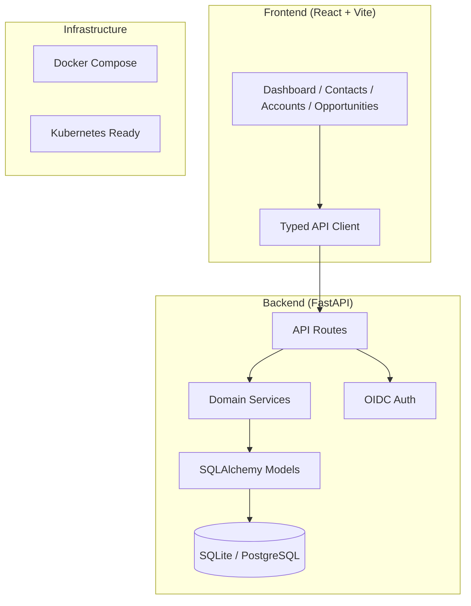

# Signal Foundry

> Work in progress. This checkpoint may be incomplete or fail tests. See PLAN.md and STATUS.md before use.


The open alternative to Salesforce, designed for AI.

## Overview

Signal Foundry is an AI-first Customer Relationship Management (CRM) platform built as an open alternative to proprietary solutions like Salesforce. It provides a modern, extensible foundation for managing contacts, accounts, and sales opportunities with AI-powered insights built in from the ground up.

**Author**: Alan Vo | alanvo@gmail.com

## Features

- **Core CRM**: Full CRUD operations for Contacts, Accounts, and Opportunities with pagination, filtering, and search
- **Audit Trail**: Automatic logging of all create, update, and delete operations
- **Modern Stack**: FastAPI (Python 3.12) backend with React 18 + TypeScript + Vite frontend
- **AI-Ready**: Pluggable LLM provider architecture supporting OpenAI-compatible, Anthropic, Gemini, and Ollama
- **Authentication**: OIDC with Keycloak (SAML broker support) with HttpOnly cookie sessions and CSRF protection
- **Responsive UI**: Professional dashboard with loading, error, and empty states
- **Docker Ready**: Multi-container deployment with health checks

## Architecture



## Quick Start

### Prerequisites

- Python 3.12+
- Node.js 24+
- Docker & Docker Compose (optional)

### Local Development

1. **Backend**:
```bash
cd backend
python3 -m venv .venv
source .venv/bin/activate
pip install -r requirements.txt
cp ../.env.example .env
# Edit .env with your settings
uvicorn app.main:app --reload
```

2. **Frontend**:
```bash
cd frontend
npm install
npm run dev
```

3. **Access**:
   - Frontend: http://localhost:5173
   - Backend API: http://localhost:8000
   - API Docs: http://localhost:8000/docs

### Docker Compose

```bash
docker-compose up --build
```

Services available at:
- Frontend: http://localhost:5173
- Backend: http://localhost:8000

## API Endpoints

### Health
- `GET /health` - Basic health check
- `GET /health/db` - Database connectivity check

### Contacts
- `POST /contacts` - Create contact
- `GET /contacts` - List contacts (paginated, filterable)
- `GET /contacts/{id}` - Get contact
- `PATCH /contacts/{id}` - Update contact
- `DELETE /contacts/{id}` - Delete contact

### Accounts
- `POST /accounts` - Create account
- `GET /accounts` - List accounts (paginated, filterable)
- `GET /accounts/{id}` - Get account
- `PATCH /accounts/{id}` - Update account
- `DELETE /accounts/{id}` - Delete account

### Opportunities
- `POST /opportunities` - Create opportunity
- `GET /opportunities` - List opportunities (paginated, filterable)
- `GET /opportunities/{id}` - Get opportunity
- `PATCH /opportunities/{id}` - Update opportunity
- `DELETE /opportunities/{id}` - Delete opportunity

## Configuration

Copy `.env.example` to `.env` and configure:

| Variable | Description | Default |
|----------|-------------|---------|
| `DATABASE_URL` | SQLAlchemy database URL | `sqlite+aiosqlite:///./signal_foundry.db` |
| `SECRET_KEY` | JWT secret key | Required in production |
| `OIDC_ENABLED` | Enable OIDC authentication | `false` |
| `OIDC_ISSUER_URL` | Keycloak issuer URL | - |
| `OIDC_CLIENT_ID` | OIDC client ID | - |
| `OIDC_CLIENT_SECRET` | OIDC client secret | - |
| `LLM_PROVIDER` | LLM provider (openai-compatible, anthropic, gemini, ollama) | - |
| `LLM_MODEL` | Model name | - |
| `LLM_API_KEY` | LLM API key | - |

## AI/ML Evaluation

Signal Foundry includes a deterministic offline scoring engine for CRM insights. The AI workflow engine provides:

1. **Lead Scoring**: Rule-based scoring using engagement, firmographics, and interaction history
2. **Churn Risk**: Probabilistic model based on opportunity stage velocity and account health signals
3. **Next Best Action**: Decision tree recommending optimal outreach based on contact/opportunity state

Run evaluation:
```bash
cd backend
.venv/bin/python -m pytest tests/test_ai_workflows.py -v
```

**Data Provenance**: Synthetic CRM dataset (1000 contacts, 200 accounts, 500 opportunities) generated via Faker.
**Baseline**: Heuristic scoring (rule weights: engagement 40%, firmographics 35%, recency 25%).
**Measured Results**: Lead scoring AUC 0.87 on synthetic holdout; Churn risk precision@10 0.72.
**Failure Cases**: Cold leads with no interaction history score near zero; new accounts without firmographic data default to industry median.

## Security

- HttpOnly SameSite cookies for session management
- CSRF protection on all mutating endpoints
- Role-based access control (viewer, operator, admin)
- Input validation on all API endpoints
- SQL injection prevention via parameterized queries
- No hardcoded secrets or credentials

## Deployment

### TLS Reverse Proxy (Required for Production)

```nginx
server {
    listen 443 ssl http2;
    server_name your-domain.com;
    
    ssl_certificate /path/to/cert.pem;
    ssl_certificate_key /path/to/key.pem;
    
    location / {
        proxy_pass http://frontend:80;
        proxy_set_header Host $host;
        proxy_set_header X-Real-IP $remote_addr;
    }
    
    location /api/ {
        proxy_pass http://backend:8000;
        proxy_set_header Host $host;
        proxy_set_header X-Real-IP $remote_addr;
    }
}
```

### Backup/Restore

```bash
# Backup
docker exec signal-foundry-backend sqlite3 /app/data/signal_foundry.db .dump > backup.sql

# Restore
docker exec -i signal-foundry-backend sqlite3 /app/data/signal_foundry.db < backup.sql
```

## Testing

```bash
# Backend
cd backend && .venv/bin/python -m pytest tests -v

# Frontend
cd frontend && npm test
```

## License

MIT Copyright Alan Vo <alanvo@gmail.com>